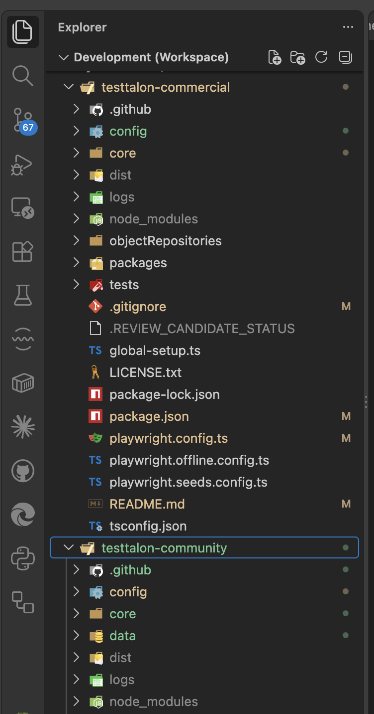
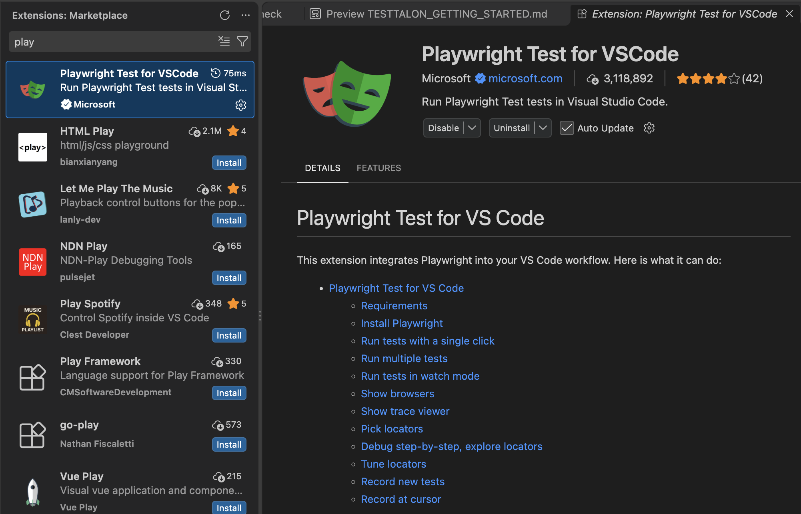
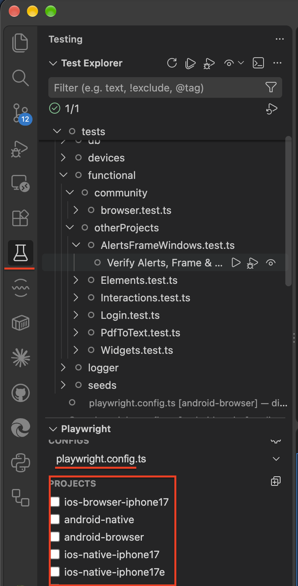
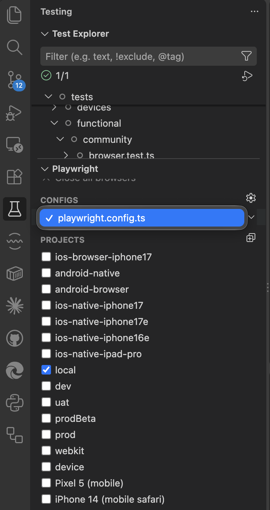
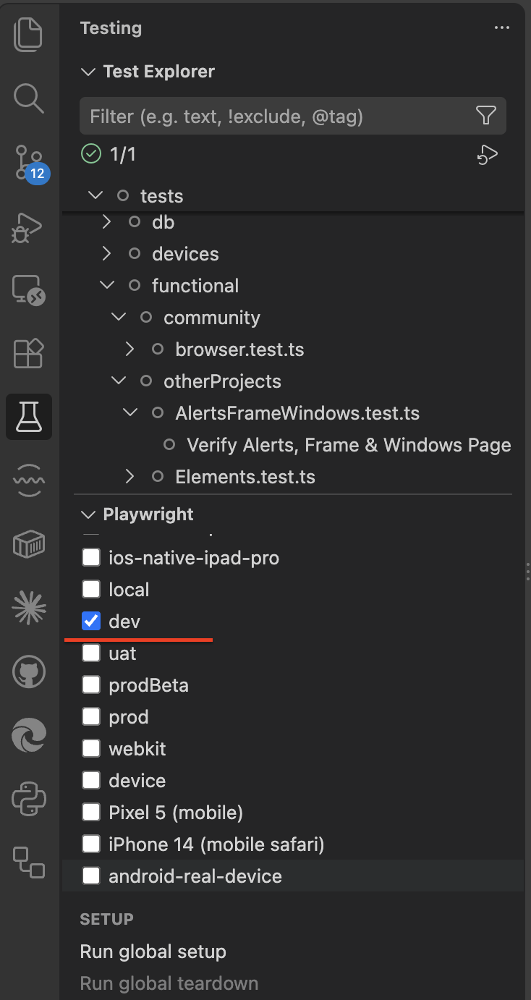
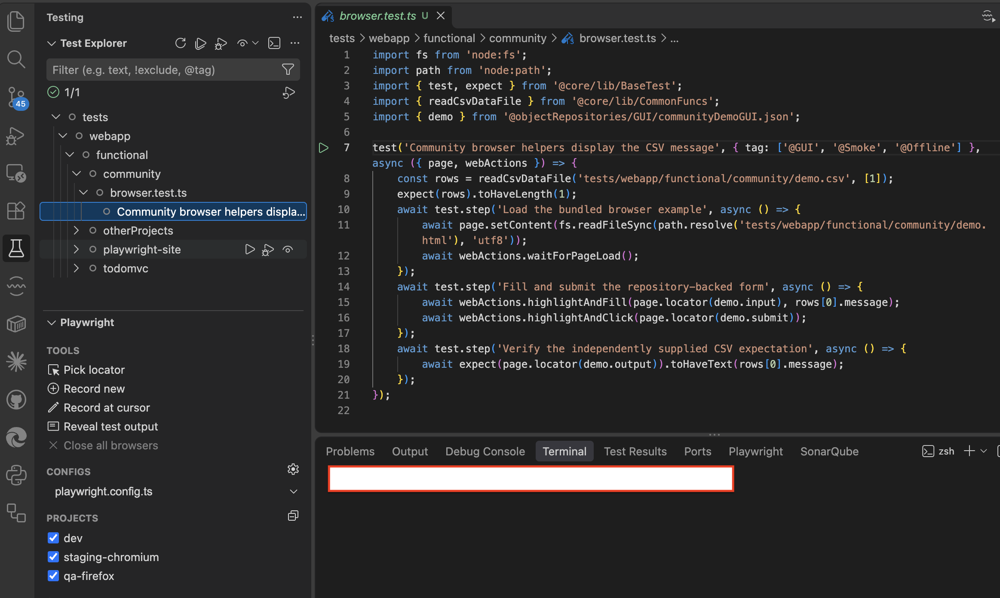
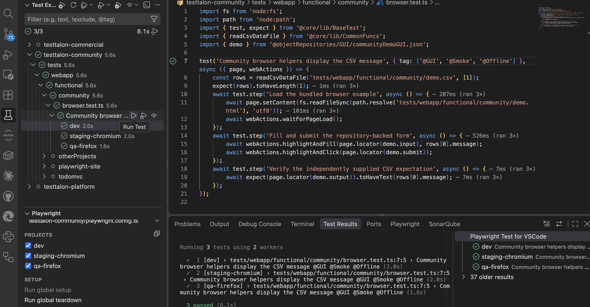
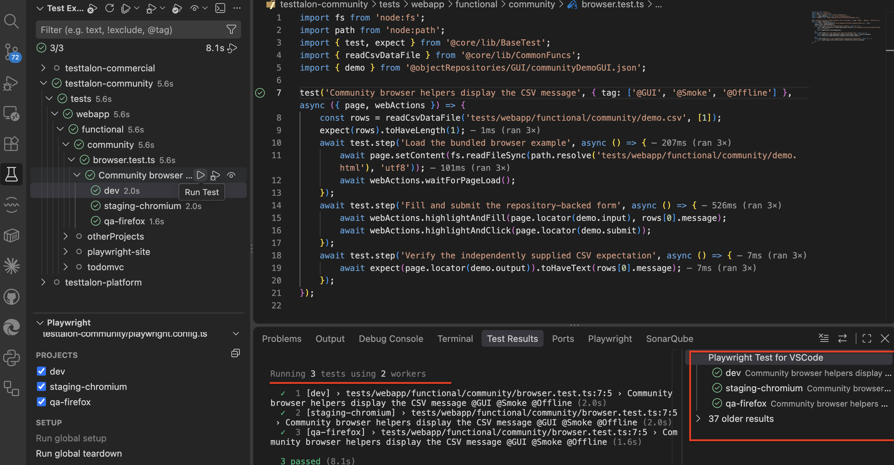
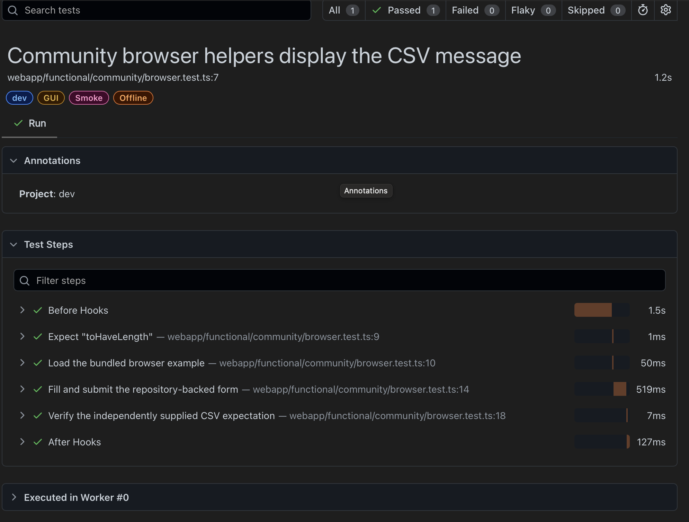

# TestTalon v2.1.0

## Installation, IDE Setup & Getting Started Guide

**From Source Code to Your First Automated Test**

This guide covers the shared setup and execution workflow for TestTalon 2.1.0 source packages. Available examples, project recipes and optional integrations depend on the installed package. Read its files before selecting a recipe; do not assume every package has the same scripts or projects.

> Screenshots may show TestTalon Commercial Edition. The general setup workflow applies to both Community and Commercial editions. Available projects, tests, and features vary by edition and configuration.

All commands run from the folder containing `package.json` unless stated otherwise. Commands and configuration have been inspected; illustrative output is not a new execution record.

## Contents

1. [Introduction](#1-introduction)
2. [System requirements](#2-system-requirements)
3. [Install an IDE](#3-install-an-ide)
4. [Download or clone TestTalon](#4-download-or-clone-testtalon)
5. [Open TestTalon in VS Code](#5-open-testtalon-in-vs-code)
6. [Install dependencies and browsers](#6-install-dependencies-and-browsers)
7. [Understand the project structure](#7-understand-the-project-structure)
8. [Configure the test environment](#8-configure-the-test-environment)
9. [Run Your First Test Using the Terminal](#9-run-your-first-test-using-the-terminal)
10. [Run Playwright Tests Using the VS Code Testing Tab](#10-run-playwright-tests-using-the-vs-code-testing-tab)
11. [View Test Results and Reports](#11-view-test-results-and-reports)
12. [Troubleshooting](#12-troubleshooting)
13. [Create Your First Automated Test](#13-create-your-first-automated-test)
14. [Best practices](#14-best-practices)
15. [Quick start reference](#15-quick-start-reference)
16. [Screenshot checklist and verification scope](#16-screenshot-checklist-and-verification-scope)

## 1. Introduction

TestTalon is a TypeScript source-code project for test automation, rather than a standalone desktop application. You open its files in an IDE, install its dependencies and execute tests using Playwright.

Playwright controls browsers, discovers tests and provides assertions, execution and debugging tools. TypeScript adds type checking and editor assistance to make tests easier to maintain. An IDE helps you navigate code, see errors, select tests, pause execution and inspect values.

By following this guide you will install the tools, run a bundled offline browser sample, choose configurations/projects in VS Code, inspect reports and create a small test using the existing TestTalon fixture and helpers. Additional capabilities in a package do not need to be configured merely to complete the shared browser exercise.

## 2. System requirements

The [package metadata](../../package.json) requires Node.js `>=24`. Choose **Node.js 24 LTS** for this guide; the [Node.js release table](https://nodejs.org/en/about/previous-releases) identifies it as an LTS line. Node.js 22 does not meet this project's requirement even though Playwright itself supports it.

| Prerequisite     | Requirement or recommendation                                                                     | How to verify                                           |
| ---------------- | ------------------------------------------------------------------------------------------------- | ------------------------------------------------------- |
| Windows          | An OS supported by Playwright; current upstream lists Windows 11+, Windows Server 2019+ or WSL    | Check Windows Settings; see upstream requirements below |
| macOS            | Current upstream Playwright requirement: macOS 14 Sonoma or later                                 | Apple menu → About This Mac                             |
| Linux            | Current upstream lists Debian 12/13 and Ubuntu 22.04/24.04/26.04, x86-64 or arm64                 | Check your distribution and architecture                |
| Node.js          | Node.js 24 LTS recommended; repository engine is `>=24`                                           | `node --version`                                        |
| npm              | Included with Node.js; no separate npm minimum or exact version is declared; lockfile format is 3 | `npm --version`                                         |
| Git              | Needed for cloning and updating; optional for ZIP setup; no minimum declared                      | `git --version`                                         |
| IDE              | Current VS Code recommended; IntelliJ alternative described below                                 | Open the installed editor                               |
| Browser binaries | Playwright-managed Chromium for the first sample; Firefox for `qa-firefox`                        | Install in Section 6                                    |
| Internet         | Needed to obtain source, dependencies and browser downloads; also for online demo tests           | Confirm downloads are accessible                        |

OS entries reflect [Playwright's upstream requirements](https://playwright.dev/docs/intro#system-requirements), not a separate TestTalon OS certification matrix. The repository does not specify minimum RAM or disk space. Consult upstream requirements if your OS is not listed.

1. Download Node.js 24 LTS from [nodejs.org](https://nodejs.org/en/download) and install the package appropriate for your OS/CPU. Include npm and PATH integration when offered.
2. For Git cloning, install Git from [git-scm.com](https://git-scm.com/downloads).
3. Open a **new** terminal after installation and run:

   ```bash
   node --version
   npm --version
   git --version
   ```

Expected shapes are `v24.x.x`, an npm version number, and `git version ...`. The `x` characters describe variable patch numbers; you do not type them. An unrecognized command means the tool is missing or the terminal has not picked up its PATH entry.

## 3. Install an IDE

### Option A — Visual Studio Code (recommended)

1. Download VS Code from [code.visualstudio.com](https://code.visualstudio.com/download).
2. Run the installer or follow your OS's application installation procedure.
3. Launch VS Code.
4. Open **Extensions** from the Activity Bar, or press `Ctrl+Shift+X` on Windows/Linux or `Cmd+Shift+X` on macOS.
5. Search for **Playwright Test for VSCode**. The listing may display **Playwright Test for VS Code**.
6. Verify **Microsoft** as publisher and extension ID `ms-playwright.playwright`, then select **Install**. Use the [official Marketplace listing](https://marketplace.visualstudio.com/items?itemName=ms-playwright.playwright).
7. Reload if VS Code requests it.

The extension discovers tests and integrates project selection, Run Test and Debug Test into the Testing view. Its icon looks like a beaker/flask. Detailed instructions appear in Section 10.

This repository already contains Playwright configuration. Install its dependencies as described below; you do not need a new-project generator or the extension's Playwright initialization wizard.

### Option B — IntelliJ IDEA

Use VS Code if you want the exact Testing-tab workflow in this guide. IntelliJ uses different controls.

1. Download and install IntelliJ IDEA from [JetBrains](https://www.jetbrains.com/idea/download/).
2. After obtaining the source, use **Open** or **File → Open** to open the existing TestTalon root folder. Do not create a fresh Playwright project over it.
3. Open Settings and search for **JavaScript Runtime**. Where the installed edition exposes runtime configuration, choose your local Node.js 24 executable and npm. See [JetBrains runtime configuration](https://www.jetbrains.com/help/idea/javascript-runtime.html).
4. Open the IDE terminal in the project root. Verify `node --version`, then run the dependency/browser commands in Section 6.
5. Open the sample TypeScript file. The terminal commands in Section 9 work independently of Playwright-specific IDE controls.
6. If your installation provides Playwright gutter actions, use the gutter Run action for the test. In its run/debug configuration, use the TestTalon root as working directory and Playwright options `--project=dev`. Choose the supplied offline configuration for the first run when present (Section 8); otherwise use the root `playwright.config.ts` and its browser prerequisites. Use the corresponding Debug action for breakpoints. Otherwise use the terminal or VS Code.

**Version/subscription distinction:** IntelliJ IDEA 2026.1 introduced core JavaScript/TypeScript editing and npm-script support without an Ultimate subscription; dedicated debugging and test-runner/UI tooling require the corresponding Ultimate features. Earlier installations may not offer the same capabilities. Check the installed version, subscription and enabled plugins against [JetBrains JavaScript documentation](https://www.jetbrains.com/help/idea/javascript-specific-guidelines.html). Its [Playwright documentation](https://www.jetbrains.com/help/idea/playwright.html) describes the **Test Automation** plugin for richer support and notes that basic run/debug does not itself require that plugin. Use the terminal if a native run/debug action is unavailable. IntelliJ does not use the Microsoft extension's VS Code Testing sidebar.

## 4. Download or clone TestTalon

Obtain source from the repository or distribution location authorized for your TestTalon package. Customers do not necessarily use the same repository, credentials, branch or download link. Use the address supplied with your package; this guide does not substitute another repository's URL.

### Method A — Source-code ZIP

1. Open your authorized repository/download location.
2. Choose the 2.1.0 source archive supplied there. On GitHub, select the relevant existing version tag, if provided, then **Code → Download ZIP**.
3. Extract the ZIP into a user-writable workspace.
4. Open the extracted folder containing `package.json`, not the archive itself or an outer wrapper directory.

A ZIP download does not create a local Git repository. The remaining installation, IDE and test-running steps are the same. Git history/update commands apply only to a Git checkout.

### Method B — Git clone

Copy the exact HTTPS clone URL from your authorized repository's **Code** control or delivery instructions. The following prompts accept that URL and deliberately name the local destination `testtalon`; this is a chosen folder name, not an assumption about the remote repository name.

In a macOS/Linux terminal:

```bash
printf 'Paste your authorized clone URL, then press Enter: '
read -r source_url
git clone "$source_url" testtalon
cd testtalon
```

In Windows PowerShell:

```powershell
$sourceUrl = Read-Host 'Paste your authorized clone URL'
git clone $sourceUrl testtalon
Set-Location testtalon
```

`source_url`/`sourceUrl` are temporary shell input variables for Git, not TestTalon configuration variables. If the destination already exists, choose a different local folder; do not overwrite existing work. Authenticate using the approved Git credential flow; do not embed a token in a clone URL or documentation.

Cloning preserves history and permits reviewed updates later. For a repository that supplies a version tag, inspect it before switching:

```bash
git tag --list v2.1.0
```

Only if that exact tag exists in your checkout and your delivery instructions identify it as the desired version, run `git switch --detach v2.1.0`. Detached HEAD selects a fixed revision; you can still inspect/run/edit it. Create your own branch before retaining future commits. Do not assume every package uses the same release tag, or switch an existing customized checkout without reviewing local changes.

### Confirm the version

```bash
node -p "require('./package.json').version"
```

Expected: `2.1.0`. Package names may vary, so use the version and the supplied documentation to confirm the intended project. If your authorized source differs, obtain the correct source before following version-specific examples.

## 5. Open TestTalon in VS Code

1. Launch VS Code and select **File → Open Folder**.
2. Navigate to the extracted/cloned TestTalon directory and select its root.
3. Trust the workspace only if it is the source you intended to obtain; execution may be restricted in an untrusted workspace.
4. Confirm Explorer shows `package.json`, `package-lock.json`, `playwright.config.ts`, `tsconfig.json`, `tests/` and `config/`.
5. Select **Terminal → New Terminal**.
6. Run `node -p "require('./package.json').version"`. It should print `2.1.0`. A missing-file error normally means the terminal is in the wrong directory.

Do not open only the `tests/` directory. Relative fixture paths and configuration discovery depend on the project root. For a multi-folder workspace, open the intended package alone for your first run.



*Figure GS-01. Example TestTalon workspace in VS Code Explorer. Open your installed TestTalon project root for setup.*

## 6. Install dependencies and browsers

### 6.1 Install the locked dependencies

The inspected packages include npm lockfiles in format 3. Existing setup/CI guidance uses:

```bash
npm ci --ignore-scripts
```

npm is Node.js's package manager. It installs the dependency versions recorded in [package-lock.json](../../package-lock.json) into generated `node_modules/`. `--ignore-scripts` skips package installation lifecycle scripts. Keep development dependencies: the build needs TypeScript.

A successful install exits without an error. Counts, notices and audit summaries vary. On failure, investigate the first error; do not delete/regenerate the lockfile or upgrade dependencies as a routine setup remedy. A clean `npm ci` replaces the generated dependency directory, so do not store your work inside `node_modules/`.

### 6.2 Install browser binaries

For the shared first-run path:

```bash
npx playwright install chromium
```

This installs the Playwright-managed browser, separately from npm dependencies. The inspected default `npm test` workflows use bundled Chromium, either directly or through the supplied offline configuration.

To install the standard browser set used by additional configured recipes:

```bash
npx playwright install
```

This downloads Chromium, Firefox and WebKit for the project's installed Playwright version. You can instead install only the needed engines, for example:

```bash
npx playwright install chromium firefox
```

**Browser engine versus channel:** a root project with `browserName: 'chromium'` and `channel: 'chrome'` needs Google Chrome; `channel: 'msedge'` needs Microsoft Edge. Downloading bundled Chromium does not satisfy those channel requirements. Use the supplied offline configuration for the first run where available. Install a branded browser only if you intend to run a recipe that requires it, following [Playwright's browser guidance](https://playwright.dev/docs/browsers).

On a supported Linux host, install required browser OS libraries with:

```bash
npx playwright install --with-deps chromium
```

OS-library installation may request administrator access. Begin with the ordinary browser install on Windows/macOS. For corporate proxies or download restrictions, use your organization's approved network settings; do not disable TLS validation.

### 6.3 Optional checks before execution

```bash
npm run build
npm run typecheck
npm run lint:tests
```

These scripts exist in the inspected packages: compile, check types, and check test conventions. They do not run the first browser sample. No optional capability initialization is needed merely for this exercise; follow your package README before enabling additional tooling.

## 7. Understand the project structure

The shared root layout is:

```text
testtalon/                       # Your chosen local folder name
├── package.json                 # Scripts and dependency declarations
├── package-lock.json            # Locked dependency versions
├── playwright.config.ts         # Canonical project/composition entry point
├── tsconfig.json                # TypeScript settings and import aliases
├── config/                      # Profiles, template, configuration helpers
│   ├── .env.example
│   └── loadProfileData.ts
├── tests/                       # Automated tests and bundled examples
├── objectRepositories/GUI/      # Reusable browser locators
├── core/                        # Utilities, data helpers and documentation
│   └── lib/GenerateData.ts
└── packages/                    # Capability and shared helper implementations
```

Some packages also include `playwright.offline.config.ts`, which derives a safe first-run recipe from the root configuration. The file is optional across packages; do not create it if your package does not ship it.

The browser example is named **`browser.test.ts`** and is located beneath `tests/`. Its containing folder includes `demo.html` and `demo.csv`; the parent directories vary by installed package. Use VS Code's file search to find the actual file instead of copying a folder path from another package. The terminal commands below select the verified filename as a Playwright file filter.

| Area                                       | Purpose and beginner guidance                                                                |
| ------------------------------------------ | -------------------------------------------------------------------------------------------- |
| Root package and lockfile                  | Installation/scripts; keep unchanged during onboarding                                       |
| Root `playwright.config.ts`                | Canonical supported project catalogue and composition                                        |
| `playwright.offline.config.ts`, if present | Safe derived browser recipe; keep its provided profile/config intact                         |
| `tests/`                                   | Add your own area folder and `.test.ts` files                                                |
| `objectRepositories/GUI/`                  | Reuse locator definitions; do not duplicate selectors throughout tests                       |
| `core/`, `packages/`                       | Framework/helper implementations; consume their public aliases rather than editing internals |
| `config/.env.example`                      | Supported variables for the installed package; copy rather than overwrite                    |

Generated folders include `node_modules/` after installation, `dist/` after build, and `logs/` after execution. Do not edit generated files. Framework file ownership varies; [tsconfig.json](../../tsconfig.json) maps `@core/lib/BaseTest`, `@core/lib/CommonFuncs` and related aliases to the installed implementation.

## 8. Configure the test environment

### 8.1 Begin with the supplied offline path

The first browser example loads bundled HTML and CSV data. It does not need a live application or private credentials. Run the package's existing `npm test` script for its supported first-run path.

Check [package.json](../../package.json) to understand that script:

- Where it selects the root config directly, the starter uses `dev` with bundled Chromium and an optional profile.
- Where it passes `--config=playwright.offline.config.ts`, that supplied config derives `dev`, removes the branded Chrome channel and selects the shipped `config/.env.offline` profile. Keep that profile in place; it contains disabled integration flags rather than secrets.

Do not enable external reporting or other integrations merely to run the sample. If your shell already enables optional integrations, clear those settings or use the disabled values documented in your installed template before starting the runner/editor. Worker profile values cannot override explicit invocation settings by default.

### 8.2 Select a project and its profile

In the root configuration, a project selects a profile through `metadata.envProfile`. For example:

```ts
metadata: { envProfile: 'dev' }
```

This selects `config/.env.dev`; it does not automatically change the project's name, browser or test scope. In packages whose root config uses a `withEnvProfile(...)` helper, read the helper call as the same metadata mapping.

The normal selection is metadata first, then project name, with `local` as a final fallback when neither supplies a name. Safe custom names must start with a letter/digit and can then contain letters, digits, `_`, `-` or single dots. Consecutive dots and path separators are rejected. No environment-variable profile selector is required.

**Missing-file behavior is package-dependent:** one fixture intentionally allows an absent profile; another requires the selected file and fails if it is missing, even when application values are injected. Treat shipped profiles as required unless the installed guidance explicitly says otherwise. An unreadable/malformed existing file or a decryption/key failure is an error, not a reason to ignore configuration loading.

### 8.3 Create a safe root-project profile when needed

For a root `dev` run, preserve an existing `config/.env.dev`. If it is absent, copy the installed [template](../../config/.env.example):

macOS/Linux:

```bash
test -e config/.env.dev || cp config/.env.example config/.env.dev
```

Windows PowerShell:

```powershell
if (-not (Test-Path config/.env.dev)) { Copy-Item config/.env.example config/.env.dev }
```

Keep any additional safe defaults/disabled flags from the installed template. Two verified GUI values are:

```dotenv
GUI_TIMEOUT=30000
HIGHLIGHT_TEST_OBJECT_ENABLED=false
```

These values form a valid minimal profile for GUI preferences. They do not replace additional prerequisite settings required by a specialized recipe. Do not overwrite an encrypted or customized profile with this snippet.

| Variable                        | Verified meaning                                                                                                                                         |
| ------------------------------- | -------------------------------------------------------------------------------------------------------------------------------------------------------- |
| `GUI_TIMEOUT`                   | Nonnegative numeric setting, default `30000` ms; available to GUI/custom waits. It does not replace all Playwright timeout settings                      |
| `HIGHLIGHT_TEST_OBJECT_ENABLED` | `true`/`false`, default `false`; used by supported highlight helpers                                                                                     |
| `GUI_BASE_URL`                  | Read by supplied online browser examples inside their test bodies; not needed for the offline example, and not automatically a root Playwright `baseURL` |
| `CI`                            | Invocation-level setting used when composing headless behavior; set before Playwright starts                                                             |

Additional variables depend on installed capabilities; use the package's own template and README rather than copying settings from another package.

### 8.4 Configuration precedence and timing

Default precedence, highest first:

1. Environment supplied when the runner starts, such as shell/CI values.
2. Values from the selected profile.
3. Framework defaults.

Profiles are activated around test execution and their changed environment is restored afterwards. Read profile values **inside tests/fixtures**, after setup. A profile loaded in a worker cannot retroactively reconfigure parent reporters, browser project composition or `use.baseURL`.

For the installed online examples, a profile may include `GUI_BASE_URL=https://playwright.dev`; the test must explicitly read it, navigate there and match that application's behavior. Adding the variable alone does not redirect every test. For an offline first run, do not add an application URL.

### 8.5 Protect credentials

Ignore rules vary between packages. Some deliberately track profile files; others ignore profiles except for specific shipped defaults. **Never assume a profile is ignored.** Check the installed [.gitignore](../../.gitignore), and in a Git checkout inspect its behavior before storing a secret.

- Keep plaintext credentials out of source, profiles, object repositories, fixtures and screenshots/reports.
- Supply CI secrets from its secret store as environment values.
- Use an external local secret/environment manager, or explicitly exclude a personal profile locally before adding secrets. Do not rely on the file starting with a dot.
- dotenvx encrypted profiles require their matching private key. Do not commit `config/.env.keys` or other private keys alongside encrypted files. Follow the installed configuration guidance for key loading; no encryption/key generation is necessary for the first sample.
- For Git checkouts, `git check-ignore config/.env.keys` should identify the ignored key file. Inspect `git status` before staging anything. A ZIP extraction does not have a Git index to check.

## 9. Run Your First Test Using the Terminal

### 9.1 Locate the existing example

Use Explorer or **Go to File** (`Ctrl+P`, macOS `Cmd+P`) and enter `browser.test.ts`. The inspected packages each have one bundled file of that name. Its parent folder contains `demo.html` and `demo.csv`. It uses the TestTalon fixture, reusable browser helpers and a GUI object repository to fill a form and verify the CSV message appears.

The filename filter `browser.test.ts` in the commands below selects this existing file despite the package-dependent parent path. If your customized checkout adds another file with that basename, use its actual root-relative path copied from Explorer to disambiguate.

### 9.2 Use the shared first-run command

After installing dependencies and Chromium:

```bash
npm test
```

Both inspected distributions use this script for a supported offline starter run. Some also run helper unit checks before the browser sample. Expect a successful exit and a browser-test summary ending with `1 passed`. Illustrative output only:

```text
Running 1 test using 1 worker
  ... [dev] ... browser.test.ts ...
1 passed
```

Timing, test labels and formatting vary. A skipped test has not validated its intended behavior.

### 9.3 Select only the starter file

Choose **one** verified command based on the files shipped in your package.

**If `playwright.offline.config.ts` exists:**

```bash
npx playwright test browser.test.ts --config=playwright.offline.config.ts --project=dev
```

**Otherwise, for the root recipe using bundled Chromium:**

```bash
npx playwright test browser.test.ts --config=playwright.config.ts --project=dev
```

Use the same command with `--list` to discover that file without executing it. These explicit-config commands are safer than allowing an unintended configuration to be selected.

To request a visible browser, append `--headed` to the applicable command. For example, with the supplied offline configuration:

```bash
npx playwright test browser.test.ts --config=playwright.offline.config.ts --project=dev --headed
```

Without that file:

```bash
npx playwright test browser.test.ts --config=playwright.config.ts --project=dev --headed
```

The starter file currently contains one test. Running the file therefore runs a single case. To stop execution, focus the terminal and press `Ctrl+C`, including on macOS. Allow cleanup to finish; an interrupted run may produce incomplete artifacts.

Do not run every root project as your first exercise. Other recipes may require application access, branded browsers, external services or device setup.

## 10. Run Playwright Tests Using the VS Code Testing Tab

Complete package/browser installation first. The following steps then run the starter without typing a test command.

### Step 1 — Install the Playwright extension

1. Open Extensions and search for **Playwright Test for VSCode**.
2. Verify Microsoft and `ms-playwright.playwright` using the [official listing](https://marketplace.visualstudio.com/items?itemName=ms-playwright.playwright).
3. Install/enable the extension for this workspace and reload if prompted.

Do not initialize a replacement project over the existing files. The screenshot below identifies the extension.



*Figure GS-02. Official Microsoft Playwright extension installed and enabled in VS Code.*

### Step 2 — Open the Testing tab

1. Click the beaker/flask **Testing** icon in the Activity Bar.
2. Wait for discovery and expand the Playwright controls if collapsed.
3. If Testing is hidden, show it from the Activity Bar context menu.



*Figure GS-03. VS Code Testing tab with the test tree and Playwright sidebar.*

### Step 3 — Select or activate `playwright.config.ts`

The extension normally discovers the root configuration after dependencies are installed. When multiple configurations appear:

1. Find the **gear icon in the Playwright sidebar**.
2. Open the configuration selector and activate the root **`playwright.config.ts`** to inspect the canonical projects.
3. Do not select an internal helper config merely because it has a similar name.
4. Refresh Testing after saving changes. If discovery remains stale, use **Developer: Reload Window** from the Command Palette.

The [official extension guide](https://playwright.dev/docs/getting-started-vscode#multiple-configurations) documents the gear selector. It may be hidden/unnecessary when only one config is found; UI layout varies by extension version.

**For the first execution:** if the package supplies **`playwright.offline.config.ts`**, activate that config and its `dev` project before running the starter. It derives its recipe from the root and avoids the root's branded-browser requirement. If the file is absent, keep the root configuration selected. This changes the active execution recipe, not which file owns the canonical project catalogue.



*Figure GS-04. Selecting the root playwright.config.ts in the Playwright configuration selector.*

### Step 4 — Load the available projects

A project is a named recipe for a browser, environment, emulated/device setting or specialized test scope. Its name is defined in the selected configuration; installing a browser does not create a project.

The following project names are verified in the inspected source packages. **Only entries present in your installed root config apply.** This is a reference catalogue across packages, not a promise that every package contains every entry.

| Verified name                                                                                | Browser/environment meaning                                                                |
| -------------------------------------------------------------------------------------------- | ------------------------------------------------------------------------------------------ |
| `dev`                                                                                        | Shared starter project name; bundled Chromium or Chrome channel depending on configuration |
| `staging-chromium`                                                                           | Chromium, staging profile and public-site example folder                                   |
| `qa-firefox`                                                                                 | Firefox, QA profile and TodoMVC example folder                                             |
| `local`                                                                                      | Chrome channel with local profile                                                          |
| `uat`                                                                                        | Edge channel with UAT profile                                                              |
| `prodBeta`                                                                                   | Firefox with corresponding profile                                                         |
| `prod`                                                                                       | WebKit with corresponding profile                                                          |
| `webkit`                                                                                     | WebKit with local profile                                                                  |
| `device`, `Pixel 4a (5G)`, `Pixel 5 (mobile)`                                                | Browser-emulation recipes in the packages that define them                                 |
| `iPhone 14 (mobile safari)`                                                                  | WebKit browser emulation                                                                   |
| `android-native`, `android-browser`                                                          | Specialized device recipes requiring their own setup; not first-run prerequisites          |
| `ios-browser-iphone17`                                                                       | Specialized device-browser recipe requiring its own setup                                  |
| `ios-native-iphone17`, `ios-native-iphone17e`, `ios-native-iphone16e`, `ios-native-ipad-pro` | Specialized device recipes; not first-run prerequisites                                    |

The supplied offline configuration, when present, exposes only its derived `dev` recipe. That is expected; select the root again to inspect its broader catalogue. Do not add a project just because a different package lists it.

### Step 5 — Select the desired project

1. In the Playwright sidebar, locate the project checkboxes.
2. Enable **`dev`** in the active first-run configuration.
3. Disable other projects for this exercise.
4. Confirm the checked name and active config before starting.

Selection controls **where/how** tests run, but each project's `testDir`, `testMatch` and ignores still apply. [Playwright's browser documentation](https://playwright.dev/docs/browsers#run-tests-on-different-browsers) explains project checkboxes. Checking two projects does not make an out-of-scope test belong to both.



*Figure GS-05. Playwright project selection with dev enabled. Available Playwright projects depend on the installed TestTalon edition and configuration.*

### Step 6 — Discover the sample

1. Expand the active config/project in the test tree as your extension groups it.
2. Find **`browser.test.ts`**, using the file search from Section 9 if necessary.
3. Expand the file to see its individual CSV-message browser test.
4. Clear Testing filters and refresh if the test is missing. Opening the file should also reveal a test Run action in its gutter.



*Figure GS-06. Sample test file and its individual test case in the Testing tree.*

### Step 7 — Run the sample test

1. Verify the active first-run configuration and `dev` selection.
2. Hover the individual test row and click its triangular Run action, or use its editor gutter Run action.
3. Watch the running indicator and wait for completion.
4. Select the result to inspect status, duration and output.

Use the test row rather than top-level Run All. A green check indicates a pass; a failed test exposes error details; skipped means that case did not execute. Read expected/received values and the source location for failures. The [VS Code Testing guide](https://code.visualstudio.com/docs/debugtest/testing) describes the result views. The extension's browser-display option can show the live browser.



*Figure GS-07. Run Test action on an individual test. The displayed projects and execution results are illustrative; use the test scope of your installed configuration.*
>


*Figure GS-08. Successful test results with status and duration from an example execution.*

### Step 8 — Debug the sample

1. Open `browser.test.ts`.
2. Click beside the line that fills the message to set a breakpoint.
3. Right-click the test and select **Debug Test**.
4. When paused, inspect the CSV rows and message in Variables or by hovering.
5. Use the toolbar to step over a statement, step into a helper or continue.
6. Stop the debugger when finished and remove the breakpoint.

Debugging reveals the value or action involved before you guess at a fix. See [VS Code debugging](https://code.visualstudio.com/docs/debugtest/debugging) for variables and stepping controls.

### Step 9 — Run tests using different projects

Return to the root config to see its available recipes. Verify the browser/channel, selected profile, disabled integrations and test scope before switching. Install the selected engine or branded browser and provide any required profile first.

For a package whose root defines **both** `prodBeta` and `webkit`, the same verified starter file is in scope for these two desktop recipes:

In the VS Code Playwright sidebar, select only `prodBeta` and run the starter test row. Then select only `webkit` and run that same row again. Apply these steps only when both projects exist in your installed root configuration.

These use Firefox and WebKit; required profiles are `config/.env.prodBeta` and `config/.env.local`. The starter still uses its local HTML, regardless of the project labels. Do not use these recipes unless they exist and their profiles are safe for local execution. In VS Code, enable one of those project names and run the same test row, then switch to the other.

For a root with `staging-chromium` and `qa-firefox`, those recipes deliberately select different example folders. The offline starter is not in their scope. You can try their own public-site examples, with network access, but this is not the same-test cross-browser exercise. Do not change shipped project scopes merely to force this example to work.

Cross-browser execution helps uncover browser-specific behavior. Keep the selected project/config visible when reading results so you know which recipe produced them.

## 11. View Test Results and Reports

### Terminal and IDE results

Terminal results show project, title, status and timing. VS Code displays statuses and error details in Testing/Test Results. Read an assertion's expected/received values and the reported source line before rerunning. A skipped test does not validate its application behavior.

### Open the actual HTML report

After a terminal run using the default reporters:

```bash
npm run showreport
```

The script opens the configured directory. The exact equivalent is:

```bash
npx playwright show-report logs/html-report
```

Do not assume the generic `playwright-report/` location: this repository uses `logs/html-report/`. The inspected browser configurations use `open: 'never'`, so the report does not automatically open after a CLI run. Leave the report server terminal running while browsing; `Ctrl+C` stops it.

| Output            | Actual location and availability                                                           |
| ----------------- | ------------------------------------------------------------------------------------------ |
| HTML report       | `logs/html-report/`, including `index.html`, after a run with the configured HTML reporter |
| JSON report       | `logs/json-report.json`, after a run with the configured JSON reporter                     |
| Failure artifacts | `logs/test-results/` beneath per-test directories                                          |
| Screenshot        | Captured only on failure when a page is available                                          |
| Video and trace   | Retained on failure; a passing run normally does not keep them                             |

These artifact defaults apply to the shared browser exercise; specialized projects or explicit overrides may disable them. Open a test in the HTML report to examine steps, duration, failure messages and available attachments. A trace helps inspect actions and page state; video/screenshots show visible behavior. These files can contain application data, so review before sharing.

VS Code may use extension-managed reporting/options. Do not assume its run produces the same on-disk HTML/JSON artifacts as a terminal run. If the HTML folder is missing, run the focused terminal command in Section 9 with the default reporters, then use `npm run showreport`. Do not override `--reporter` when you want the configured reports.

See the installed [README](../../README.md) for package-specific reporting guidance. New runs can replace the prior report, so copy evidence you need before running again.



*Figure GS-09. Actual Playwright HTML report showing the project, passed status, duration and test steps.*

## 12. Troubleshooting

| Problem                                       | Possible cause                                                         | Actionable resolution                                                                                                                                      |
| --------------------------------------------- | ---------------------------------------------------------------------- | ---------------------------------------------------------------------------------------------------------------------------------------------------------- |
| Node.js not found                             | Installation absent or PATH stale                                      | Install Node.js 24 LTS with PATH integration; reopen the terminal/IDE and check `node --version`                                                           |
| npm not found                                 | npm missing or wrong PATH                                              | Verify Node installation includes npm; open a new terminal; run `npm --version`                                                                            |
| PowerShell blocks `npm.ps1`                   | Local execution policy                                                 | Use `npm.cmd`/`npx.cmd` for the same commands or Command Prompt; follow policy rather than weakening it globally                                           |
| Dependency install fails                      | Version, network/proxy, permissions or package/lock mismatch           | Read the first npm error; verify Node version and approved network access; use a writable folder and matching lockfile; do not regenerate it casually      |
| Browser executable missing                    | Required binary not installed                                          | Use `npx playwright install chromium` for the starter; inspect the selected project before installing other engines                                        |
| Chrome/Edge missing despite Chromium download | Root project selects a branded channel                                 | Use the supplied offline config for onboarding, or install the intended branded browser for that root recipe                                               |
| Browser fails on Linux                        | Missing libraries or unsupported OS                                    | Confirm upstream OS support; use `npx playwright install --with-deps chromium` with permitted OS administration                                            |
| Testing shows no tests                        | Extension disabled, dependencies absent, workspace trust/filter issue  | Enable the Microsoft extension for the workspace, finish installation, review trust/filter state and refresh                                               |
| Root config not detected                      | Wrong root folder or import error                                      | Open the folder containing `package.json`; inspect extension output; use the root `--config=playwright.config.ts --list` command                           |
| No projects or unexpected project list        | Wrong config selected                                                  | Inspect the root for its catalogue; the supplied offline config intentionally exposes only `dev`                                                           |
| Starter missing from a project                | Different project test scope                                           | Select the first-run `dev` recipe; check `testDir`/`testMatch`, not only the checkbox                                                                      |
| Profile missing/load failure                  | Required file absent, bad name/syntax or wrong key                     | Preserve shipped defaults; copy the package template only when the intended profile is absent; validate name and `KEY=value` syntax; provide keys securely |
| Sample fails                                  | Wrong working directory, missing fixture, altered test or prerequisite | Use `npm test` from the root first; inspect the earliest error; find the sample's adjacent HTML/CSV; do not weaken assertions                              |
| Online example skips                          | Its application setting is absent                                      | Check the selected recipe/profile and its documented URL; a skip is not coverage                                                                           |
| Browser window hidden                         | CI/headless setting or extension display option                        | Append `--headed` to the applicable focused command or enable the extension's browser-display option                                                       |
| HTML report missing                           | No completed run with the configured HTML reporter                     | Run `npm test` or the appropriate focused CLI command without reporter overrides, then `npm run showreport`                                                |
| Multiple starter files selected               | Customized checkout duplicates the basename                            | Copy the intended file's actual root-relative path from Explorer and use it in place of the filename filter                                                |
| Optional service is contacted unexpectedly    | Invocation settings enable an integration                              | Stop the run; inspect the installed template/settings and disable the integration before restarting runner/editor                                          |

For package-specific setup, refer to the installed [README](../../README.md). Read error paths/categories without printing credentials or private key contents.

## 13. Create Your First Automated Test

This exercise creates a self-contained local page and checks its title. It uses the TestTalon test fixture and browser helper; there are no application locators or credentials to invent.

1. Under `tests/`, create `getting-started/` if it does not exist.
2. Create **`title.test.ts`**. The `.test.ts` suffix makes it discoverable.
3. Add:

   ```ts
   import { test, expect } from '@core/lib/BaseTest';

   test('shows the practice page title', { tag: ['@GUI', '@Offline'] }, async ({ page, webActions }) => {
       await page.setContent('<!doctype html><html><head><title>TestTalon practice</title></head><body>Ready</body></html>');
       await webActions.waitForPageLoad();
       await expect(page).toHaveTitle('TestTalon practice');
   });
   ```

4. Save the file. Where the supplied offline config exists, run:

   ```bash
   npx playwright test tests/getting-started/title.test.ts --config=playwright.offline.config.ts --project=dev
   ```

   Otherwise, for the root bundled-Chromium starter recipe:

   ```bash
   npx playwright test tests/getting-started/title.test.ts --config=playwright.config.ts --project=dev
   ```

5. Expected result: one passed test. This tutorial has been checked statically, not newly executed as part of writing this guide.
6. In VS Code, keep the same first-run config and `dev` selected, refresh Testing, then run the new test. Set a breakpoint and choose **Debug Test** to inspect it.
7. After a terminal run, open `npm run showreport`. Check your edit with `npm run typecheck` and `npm run lint:tests`.

`test`/`expect` come from the installed framework alias, so profile/fixture behavior remains intact. `page` is the isolated browser page; `webActions` is the existing helper fixture. A local page title is a simple assertion whose expected value is controlled by the exercise. For application tests, reuse existing object repositories and independent test data instead of hardcoding credentials or fragile selectors.

The practice file is for you to create; producing this guide did not add or modify an executable test.

## 14. Best practices

- Give tests names that describe the user-visible result.
- Keep tests independent; avoid relying on a previous test's page or data.
- Keep credentials out of source, profiles, fixtures and reports unless protected as described in Section 8.
- Select profiles through the existing project metadata and read their values after fixture setup.
- Keep selectors in object repositories; prefer stable test IDs/accessible names when creating repositories for your application.
- Reuse `webActions`, CSV helpers and existing data utilities instead of copying framework internals.
- Prefer auto-waiting assertions and meaningful readiness conditions over fixed sleeps.
- Inspect the first error and captured artifacts before rerunning. A skip is not successful coverage.
- Preserve dependency versions with the lockfile; do not casually update packages during onboarding.
- Do not commit generated dependencies, compiled output, reports, browser artifacts, authentication state or private keys. Review staged files before any commit.

## 15. Quick start reference

1. Install Node.js 24 LTS and check Node/npm.
2. Install VS Code.
3. Install/enable Microsoft's Playwright extension.
4. Obtain the authorized TestTalon 2.1.0 source by ZIP or Git.
5. Open its root folder.
6. Install locked dependencies.
7. Install Chromium for the starter.
8. Open Testing.
9. Select the root config to inspect projects; use the supplied offline config for the first execution if present.
10. Enable `dev` and disable unwanted projects.
11. Find/run the existing `browser.test.ts` case.
12. Inspect Test Results; use a terminal run for the configured HTML report.

Shared terminal quick start, from the installed project root:

```bash
npm ci --ignore-scripts
npx playwright install chromium
npm test
npm run showreport
```

| Purpose                          | Shared command or selection                                |
| -------------------------------- | ---------------------------------------------------------- |
| Confirm package version          | `node -p "require('./package.json').version"`              |
| Compile                          | `npm run build`                                            |
| Type-check                       | `npm run typecheck`                                        |
| Test conventions                 | `npm run lint:tests`                                       |
| Canonical project/test discovery | `npx playwright test --config=playwright.config.ts --list` |
| Safe default starter             | `npm test`                                                 |
| Focused starter                  | Choose the explicit config command in Section 9            |
| Headed execution                 | Append `--headed` to that focused command                  |
| HTML report                      | `npm run showreport`                                       |
| Direct HTML report viewer        | `npx playwright show-report logs/html-report`              |

Other scripts are package-specific. Read `package.json` rather than assuming an optional `test:dev`, `test:unit`, `test:list` or run-all script exists or has the same scope everywhere. An unfiltered `npx playwright test` can select projects that require further setup.

## 16. Screenshot checklist and verification scope

### Screenshot reference

The nine reviewed screenshots are illustrative examples from TestTalon workspaces. Their project lists do not define the projects available in your installed package. Follow your own configuration and test scopes; a project visible in a historical capture is not an instruction to restore or add it.

| ID    | Filename                         | Content                                                         |
| ----- | -------------------------------- | --------------------------------------------------------------- |
| GS-01 | `gs-01-project-explorer.png`     | Example project Explorer                                        |
| GS-02 | `gs-02-playwright-extension.png` | Microsoft extension and publisher                               |
| GS-03 | `gs-03-testing-tab.png`          | Testing icon and Playwright sidebar                             |
| GS-04 | `gs-04-config-selection.png`     | Root configuration selector                                     |
| GS-05 | `gs-05-project-selection.png`    | Project selection; availability varies by edition/configuration |
| GS-06 | `gs-06-sample-discovery.png`     | Sample file and individual test case                            |
| GS-07 | `gs-07-run-sample.png`           | Individual Run Test action                                      |
| GS-08 | `gs-08-sample-passed.png`        | Passed results and duration                                     |
| GS-09 | `gs-09-html-report.png`          | Actual HTML report and test steps                               |

UI wording and layout may vary by editor and extension version. Use the instructions alongside each figure and the projects in your installed configuration.

### Further reading and verification scope

- Installed [README](../../README.md): package-specific setup, scripts and examples.
- [Root configuration](../../playwright.config.ts): canonical project catalogue.
- [Profile loader](../../config/loadProfileData.ts): implemented loading/precedence contracts.
- [TypeScript configuration](../../tsconfig.json): installed aliases and compilation scope.
- [Official Playwright VS Code guide](https://playwright.dev/docs/getting-started-vscode): extension controls.
- [Official browser guide](https://playwright.dev/docs/browsers): binaries, channels and OS dependencies.

Prepared for TestTalon 2.1.0 using the relevant source, package scripts and configuration from available local packages. Shared commands, filename filters, project names, profiles, reporting paths, aliases and links were inspected. No packages were installed, tests executed, configuration changed or new IDE session exercised for this documentation task. Console output is illustrative. The supplied screenshots show example sessions; reviewing them does not constitute a new interactive IDE session or test execution.
